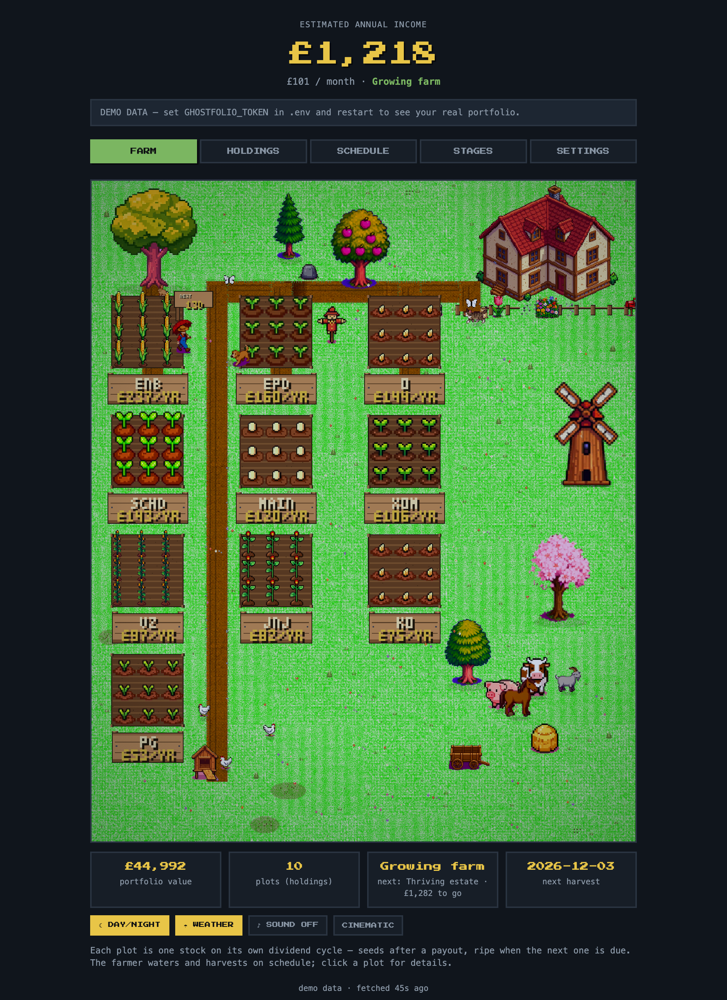
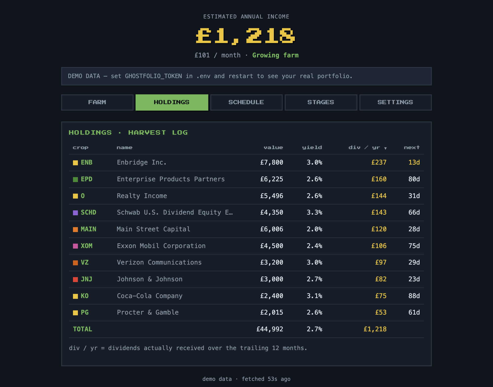
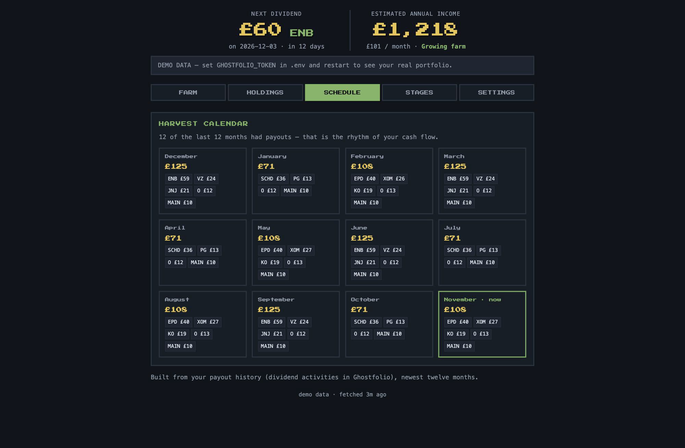
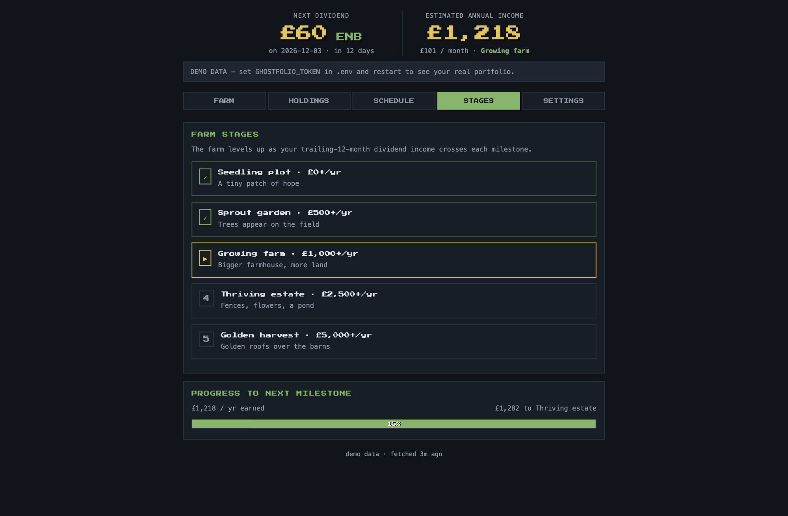
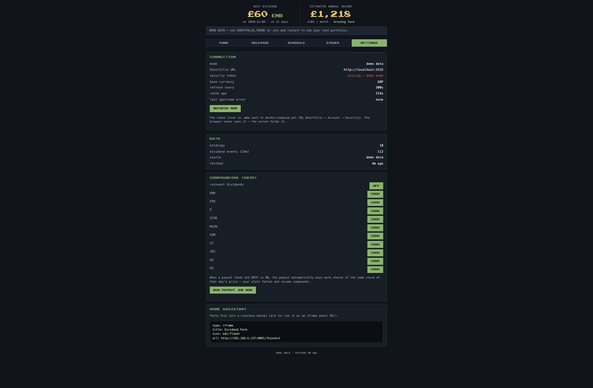

<div align="center">

# 🌾 Dividend Dashboard

**A pixel-art farm that grows your dividend portfolio — live in Home Assistant.**

Every stock you own is a crop plot. Seeds go in the ground after each payout,
the plants grow through five Harvest-Moon stages as the next dividend
approaches, and ripen exactly when the money lands. The whole farm levels up
as your annual income crosses milestones — cottage, trees, windmill, pond.

*Self-hosted. Data stays on your network. No paid API services.*



</div>

## What is this?

A self-hosted web dashboard that renders your dividend portfolio as a living
pixel-art farm, designed to sit in a Home Assistant dashboard so you stop
staring at red/green price charts. Built for the Harvest Moon / Stardew Valley
feeling: plant, water, grow, harvest — except the crops are your dividends.

Inspired by the [Trading 212 pixel-art farm on Reddit](https://www.reddit.com/r/trading212/comments/1y0hzt2/) —
wired to your own **Ghostfolio** instance instead.

## Why Ghostfolio?

The dashboard needs your portfolio: holdings, quantities, and — most
importantly — **dividend payout dates**. Every market-data API for that is
paid: Financial Modeling Prep, Polygon, Alpha Vantage, EOD — all keyed,
metered, and priced per month.

[Ghostfolio](https://github.com/ghostfolio/ghostfolio) replaces that entire
layer for free:

- **Open source (AGPL), self-hosted** — your transactions live in your own
  Postgres, on your own network. Positions never leave your home.
- **It computes everything the farm needs** — holdings, quantities, and the
  full dividend-activity history per stock. The dashboard derives each
  stock's payout cycle from those dates.
- **Market quotes** come from Ghostfolio's own free data providers — the
  dashboard never talks to a paid service.
- **One local API** — the dashboard reads one endpoint on your LAN. No keys
  in the browser, no per-service accounts.

So the stack is: **Ghostfolio (data) → Dividend Dashboard (rendering) →
Home Assistant (display)**.

## The five views

| | |
|---|---|
| **Farm** — each holding is a crop plot on its own dividend cycle: seeds after a payout, five growth stages, ripe with a sparkle when the next dividend is due. The farmer waters (soil stays dark all day), harvests ready crops, plants fresh seeds. Chickens, a pig, a cow, a horse, a goat, a cat, ducks and butterflies live here; animals path home and sleep at night. |  |
| **Holdings** — the harvest log: value, yield, trailing-12-month dividends and a per-stock days-to-payout countdown. |  |
| **Schedule** — the harvest calendar: the last 12 months of real payout history from your Ghostfolio activities, per stock, per month. |  |
| **Stages** — the farm levels up as your annual dividend income crosses milestones: Seedling plot → Sprout garden → Growing farm → Thriving estate → Golden harvest. |  |
| **Settings** — connection health, refresh interval, and the ready-to-paste Home Assistant card. | |

Plus: a continuous **day/night cycle** from your real clock (dawn pink, noon,
orange dusk, blue night with fireflies and glowing windows), **seasons**
(spring blossom, summer green, autumn colors + falling leaves, winter snow
and a snowman), **weather** (rain with streaks and splashes — and rainy days
auto-water the crops, just like the game), harvest-countdown signs, crow
swoops, pig truffles, and a spinning weathervane at the golden-roof level.

## Quick start

```bash
git clone https://github.com/kieuhoang24-prog/dividend-dashboard.git
cd dividend-dashboard
cp .env.example .env      # change the secrets, paste your Ghostfolio token later
docker compose up -d --build
```

### First run

1. Open **http://localhost:3333** → create your Ghostfolio account (first
   user = admin).
2. Import your activities (*Portfolio → Activities → Import*): your **BUY**
   trades and **DIVIDEND** payouts. The farm runs on whatever you record —
   the growth cycles come from the dividend dates.
3. In Ghostfolio: **My Ghostfolio → Account → Security → Security token →
   copy**.
4. Paste it into `.env` as `GHOSTFOLIO_TOKEN=…` and restart the dashboard:
   `docker compose up -d dashboard`
5. Open **http://localhost:8090** — your real portfolio, growing.

No token yet? The dashboard runs a deterministic **demo farm** so you can see
everything working first.

## Home Assistant

Settings → copy the iframe card, or paste this into a Lovelace manual card:

```yaml
type: iframe
title: Dividend Farm
icon: mdi:flower
url: http://YOUR_HOST:8090/?kiosk=1
```

Kiosk mode (`?kiosk=1`) hides all chrome for wall panels. The scene follows
your real clock, so a tablet on the wall shows the farm's whole day.
`?hour=9` / `?hour=22` pin any time of day for testing.

## Configuration

| Variable | Default | Meaning |
|---|---|---|
| `GHOSTFOLIO_URL` | `http://ghostfolio:3333` | Where the dashboard reaches Ghostfolio |
| `GHOSTFOLIO_TOKEN` | *(empty → demo mode)* | Your Ghostfolio security token (server-side only) |
| `BASE_CURRENCY` | `GBP` | Display currency |
| `REFRESH_SECONDS` | `300` | Data refresh cadence |
| `PORT` | `8090` | Dashboard port |
| `CACHE_QUOTES_TTL` | `3600` | Ghostfolio quote-cache seconds (upstream default 60). 3600 keeps provider calls ~24 batched requests/day — inside the free data source's daily limit. |

## Maintenance

```bash
docker compose up -d --build   # update after git pull
docker builder prune -f        # if a rebuild ever serves stale layers
docker compose down -v         # teardown (deletes Ghostfolio data!)
```

Backup the named volumes `postgres` and `redis` for Ghostfolio's data.

## Asset pipeline

All art is generated on your own hardware (ComfyUI) and converted to true
pixel art by the tools in `tools/`:

```
gen_sprites.py   # generate sprite sheets + ground tiles (Z-Image Turbo / qwen_image_2.1)
key_sprites.py   # chroma-key the magenta backdrop, normalize pixel density
pixelate.py      # true low-res grids + shared 40-color palette + outlines
```

Smooth pre-pixel versions are kept in `tools/smooth/`, pristine keyed
masters in `tools/keyed/` for instant rollback.

## Tech

React + Vite + TypeScript · Hono (Node) · canvas rendering · Docker Compose
(dashboard + ghostfolio + postgres + redis). Portfolio data is fetched
server-side and cached; nothing is stored by this app, and nothing leaves
your network except Ghostfolio's own market-data calls.

## License

MIT — do keep the pixel farmers company.
